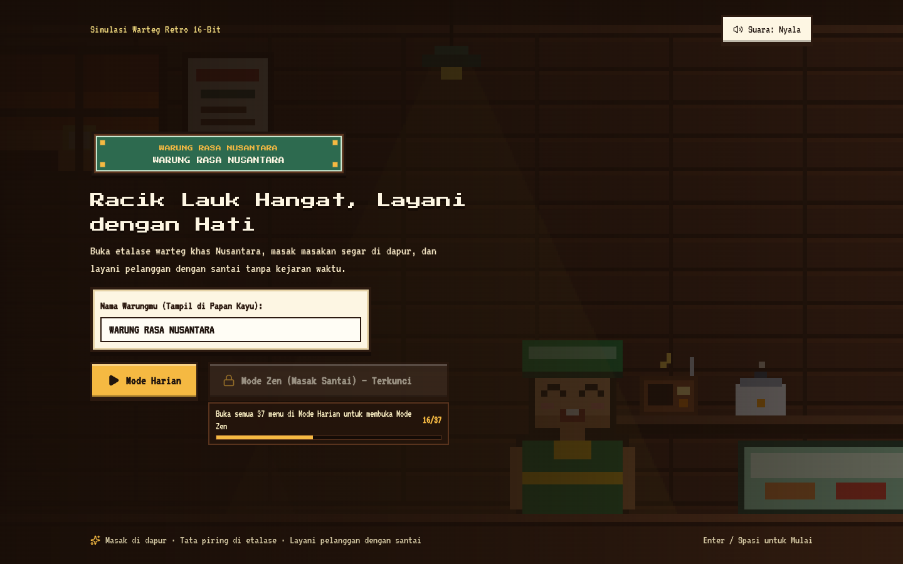
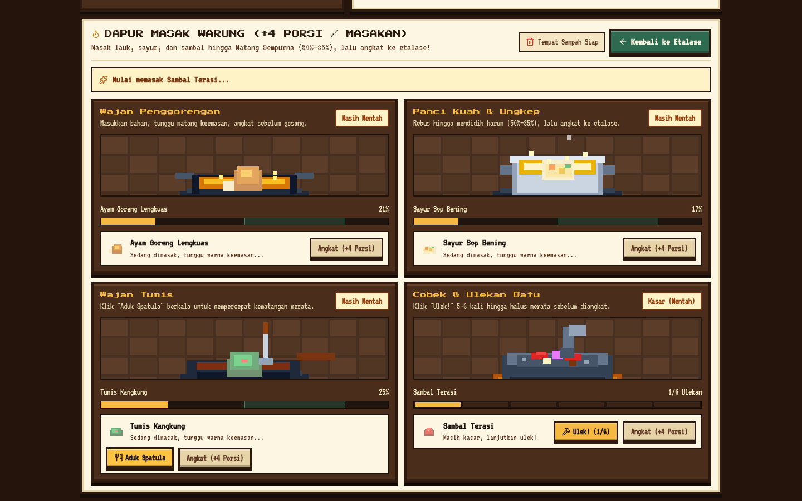
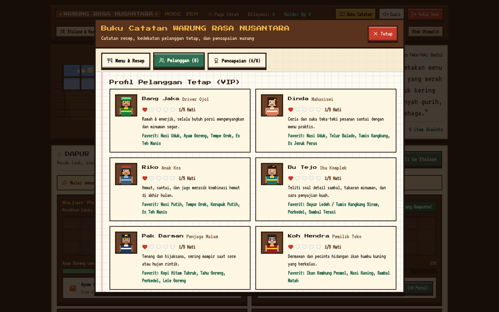

# Warung Rasa Nusantara

[](https://react.dev/)
[](https://www.typescriptlang.org/)
[](https://tailwindcss.com/)
[](https://vite.dev/)

Warung Rasa Nusantara adalah game simulasi warung makan bergaya retro pixel art 16-bit berbasis web. Permainan ini berfokus pada manajemen santai tanpa batasan waktu maupun penalti stres. Pemain meracik pesanan makanan, mengolah bahan di dapur, berinteraksi dengan pelanggan, dan mengelola keuangan harian warung.

Seluruh elemen visual (karakter, masakan, interior warung, dan efek cuaca) serta audio (efek suara dan musik latar) digambar dan disintesis secara prosedural di peramban menggunakan HTML5 Canvas, SVG, dan Web Audio API, tanpa memerlukan berkas aset eksternal.

---

## Cuplikan layar

### Menu utama
Tampilan awal untuk mengatur nama warung, memilih mode permainan (Mode Harian atau Mode Zen), dan memantau progres pembukaan resep.



### Meja racik dan etalase
Area permainan utama yang memuat diorama warung, dialog pesanan pelanggan, meja racik untuk menyiapkan piring atau minuman, serta etalase makanan dengan lima kategori.


### Dapur interaktif
Dapur memasak dengan empat stasiun: Wajan Penggorengan, Panci Kuah dan Ungkep, Wajan Tumis, serta Cobek dan Ulekan Batu. Setiap masakan matang sempurna menambah stok etalase sebanyak empat porsi.



### Buku catatan warung
Modal catatan yang berisi daftar resep masakan, profil pelanggan VIP beserta tingkat kedekatan hati, dan daftar pencapaian.



---

## Fitur utama

- **37 Menu masakan khas Nusantara**:
  - Terdiri dari 5 kategori: Karbo (4 menu), Lauk Utama (9 menu), Lauk Pendamping (8 menu), Sayur, Kuah dan Sambal (9 menu), serta Minuman (7 menu).
  - Pilihan penyajian fleksibel: kuah disiram langsung ke nasi atau dipisah ke mangkuk, es normal atau tanpa es, serta teh manis atau tawar.
- **Dapur interaktif dan manajemen stok**:
  - 4 stasiun memasak dengan mekanisme berbeda: wajan goreng, panci kuah, wajan tumis dengan tombol aduk, dan cobek batu dengan tombol ulek.
  - Tiga indikator kematangan: mentah, matang sempurna, dan gosong. Masakan yang matang sempurna memberi tambahan 4 porsi stok ke etalase serta bonus tip makanan segar (*freshly cooked*).
- **20 Karakter pelanggan dan sistem kedekatan VIP**:
  - 12 pelanggan reguler dengan pola pesanan langsung, petunjuk teka-teki, porsi ekstra, atau pesanan bertema cuaca.
  - 8 pelanggan tetap (VIP) dengan tingkat kedekatan 1 sampai 5 hati. Mencapai 3 dan 5 hati membuka total 16 resep rahasia.
- **Siklus waktu dan audio prosedural**:
  - Perubahan waktu dan cuaca otomatis (pagi cerah, sore senja, dan hujan rintik) yang memengaruhi pencahayaan latar, partikel visual, dan preferensi pesanan.
  - Musik latar dan efek suara retro yang disintesis langsung menggunakan Web Audio API.
- **Dua mode permainan**:
  - Mode Harian: simulasi harian dengan rekapitulasi finansial (pendapatan, pengeluaran bahan, tip, dan laba bersih) serta toko peningkatan perlengkapan warung.
  - Mode Zen: mode santai tanpa batasan target, dapat diakses setelah membuka seluruh 37 menu di Mode Harian.
- **Penyimpanan otomatis**:
  - Seluruh progres permainan disimpan secara lokal di peramban menggunakan `localStorage`.

---

## Teknologi yang digunakan

| Komponen | Teknologi | Deskripsi |
|---|---|---|
| Framework antarmuka | [React 19](https://react.dev/) | Library UI komponen berbasis TypeScript |
| Bahasa pemrograman | [TypeScript 5](https://www.typescriptlang.org/) | Pengetikan statis untuk keandalan kode |
| Alat build | [Vite 8](https://vite.dev/) | *Bundler* dan server pengembangan lokal cepat |
| Tata letak dan gaya | [Tailwind CSS v4](https://tailwindcss.com/) | Utilitas styling modern untuk antarmuka web |
| Ikon | [Lucide React](https://lucide.dev/) | Kumpulan ikon antarmuka ringan |
| Tipografi | Google Fonts (`VT323`, `Press Start 2P`) | Font retro bergaya piksel |
| Grafis visual | HTML5 Canvas 2D & SVG | Rendering sprite dan partikel secara prosedural |
| Sintesis audio | Web Audio API | Sintesis oscillator dan noise buffer untuk BGM serta efek suara |
| Penyimpanan data | Browser `localStorage` | Persistensi progres permainan di sisi klien |

---

## Struktur direktori

```text
├── artifacts/                  # Cuplikan layar antarmuka untuk dokumentasi
├── src/
│   ├── components/             # Komponen antarmuka React
│   │   ├── DailySummaryModal.tsx # Laporan harian dan toko perlengkapan
│   │   ├── EtalasePanel.tsx      # Etalase makanan dan indikator stok
│   │   ├── GameCounter.tsx       # Tampilan nama warung, cuaca, dan pesanan
│   │   ├── KitchenPanel.tsx      # Panel 4 stasiun memasak di dapur
│   │   ├── NotebookModal.tsx     # Buku catatan resep, VIP, dan pencapaian
│   │   ├── PixelSprite.tsx       # Komponen perender piksel makanan
│   │   ├── PlatingStation.tsx    # Meja racik piring, mangkuk, dan minuman
│   │   └── TitleScreen.tsx       # Menu utama dan pengaturan nama warung
│   ├── game/                   # Logika permainan dan data inti
│   │   ├── audio.ts              # Sintesis suara dan musik berbasis Web Audio API
│   │   ├── data.ts               # Data menu, resep rahasia, VIP, dan pelanggan
│   │   ├── pixelArt.ts           # Generator grafis Canvas prosedural
│   │   ├── rules.ts              # Aturan evaluasi pesanan dan logika dapur
│   │   ├── rules.test.ts         # Pengujian logika permainan
│   │   └── types.ts              # Definisi tipe TypeScript
│   ├── App.tsx                 # Orkestrasi status permainan utama
│   ├── index.css               # Definisi styling Tailwind dan font
│   └── main.tsx                # Titik masuk utama aplikasi React
├── index.html                  # Dokumen HTML utama
├── package.json                # Konfigurasi dependensi dan skrip proyek
├── tsconfig.json               # Konfigurasi TypeScript
└── vite.config.ts              # Konfigurasi Vite
```

---

## Prasyarat dan instalasi

Pastikan Node.js (versi 18 ke atas) dan npm telah terpasang di perangkat Anda.

### 1. Klon repositori

```bash
git clone <url-repositori>
cd warung-rasa-nusantara
```

### 2. Pasang dependensi

```bash
npm install
```

### 3. Jalankan server pengembangan

```bash
npm run dev
```

Aplikasi dapat diakses melalui peramban di `http://localhost:3000`.

---

## Skrip yang tersedia

Proyek ini menyediakan sejumlah perintah npm untuk kebutuhan pengembangan dan kompilasi:

| Perintah | Fungsi |
|---|---|
| `npm run dev` | Menjalankan server pengembangan lokal di `http://localhost:3000` |
| `npm run build` | Melakukan kompilasi kode ke direktori `dist/` untuk produksi |
| `npm run preview` | Menjalankan pratinjau lokal dari hasil kompilasi produksi |
| `npm run lint` | Menjalankan pemeriksaan tipe kode dengan TypeScript (`tsc --noEmit`) |
| `npm run clean` | Menghapus direktori `dist/` dan berkas `server.js` |
| `npx tsx --test src/game/rules.test.ts` | Menjalankan pengujian unit untuk logika aturan permainan |
