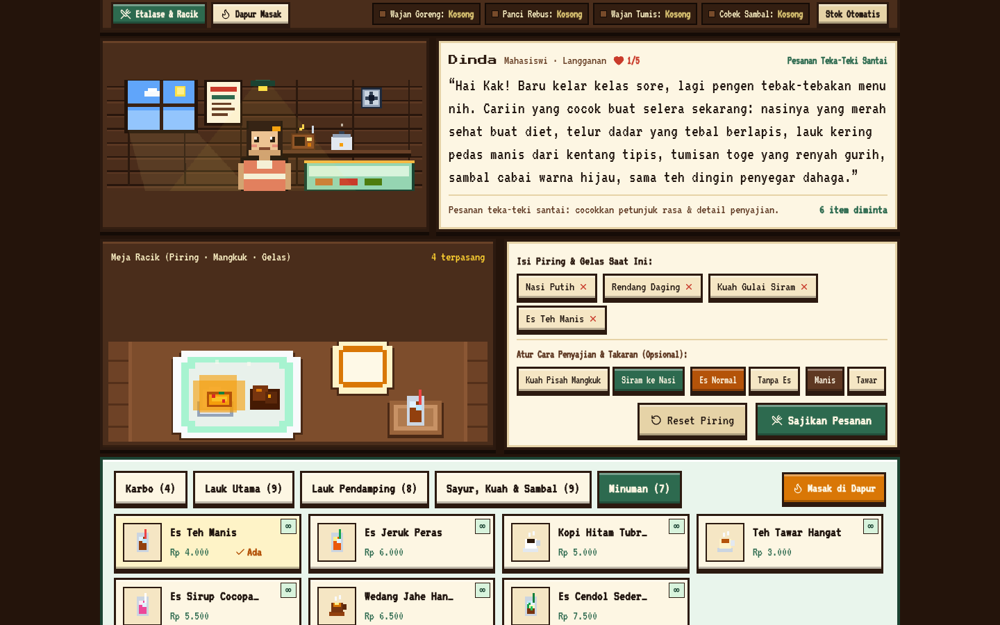

# 🍛 Warung Rasa Nusantara

[](https://react.dev/)
[](https://www.typescriptlang.org/)
[](https://tailwindcss.com/)
[](https://developer.mozilla.org/en-US/docs/Web/API/Canvas_API)
[](https://developer.mozilla.org/en-US/docs/Web/API/Web_Audio_API)
[](https://vite.dev/)

**Warung Rasa Nusantara** adalah game simulasi warung makan (warteg) bergaya *Cozy Retro 16-Bit Pixel Art* berbasis web. Tanpa timer panik dan tanpa penalti stres, pemain diajak meracik piring hangat, memasak masakan segar di dapur, berinteraksi dengan pelanggan dari penjuru kampung, serta menikmati suasana warteg yang akrab.

Seluruh aset visual (karakter, makanan, etalase kaca hijau, papan kayu, hingga efek hujan) dan audio (musik latar hangat & efek suara 8-bit) digambar dan disintesis secara **100% prosedural** di browser menggunakan **HTML5 Canvas**, **SVG**, dan **Web Audio API** tanpa dependensi file gambar atau audio eksternal.

---

## 📸 Cuplikan Layar (*Screenshots*)

### 1. Menu Utama & Kustomisasi Nama Warung
Tampilan awal dengan papan nama kayu pixel art interaktif, kustomisasi nama warung *real-time*, pemilihan **Mode Harian**, serta indikator progres pembukaan **Mode Zen (Masak Santai)**.


### 2. Konter Pelanggan, Meja Racik & Etalase Warung
Layar utama permainan menampilkan diorama warung dengan cuaca dinamis, dialog pesanan pelanggan, **Meja Racik** lengkap dengan opsi penyajian (*Kuah Siram/Pisah*, *Es Normal/Tanpa Es*, *Manis/Tawar*), serta **Etalase** kaca hijau 5 kategori dan pemantau kompor mini.



### 3. Dapur Masak Interaktif (4 Stasiun Memasak)
Area dapur retro dengan 4 stasiun interaktif (**Wajan Penggorengan**, **Panci Kuah & Ungkep**, **Wajan Tumis**, dan **Cobek & Ulekan Batu**) lengkap dengan indikator fase kematangan **Mentah**, **Matang Sempurna**, hingga risiko **Gosong** untuk mengisi ulang stok etalase (*+4 porsi* per masakan matang).


### 4. Buku Catatan Warung (Ensiklopedia & Pelanggan VIP)
Modal bergaya buku tulis kotak-kotak retro berisi daftar **Menu & Resep Rahasia**, profil **Pelanggan Tetap (VIP)** lengkap dengan meteran hati, serta daftar **Pencapaian (*Achievement*)**.


---

## ✨ Fitur Game

- **37 Menu Khas Nusantara & Detail Penyajian:**
  - Terbagi dalam 5 kategori etalase: **Karbo** (4), **Lauk Utama** (9), **Lauk Pendamping & Gorengan** (8), **Sayur, Kuah & Sambal** (9), dan **Minuman** (7).
  - Mendukung detail takaran dan cara penyajian: **Kuah Pisah Mangkuk** vs **Siram ke Nasi**, **Es Normal** vs **Tanpa Es**, serta **Manis** vs **Tawar**.
- **Dapur Masak Interaktif & Sistem Stok:**
  - **4 Stasiun Memasak:** *Wajan Penggorengan*, *Panci Kuah & Ungkep*, *Wajan Tumis* (dengan tombol *Aduk Spatula*), dan *Cobek & Ulekan Batu* (dengan tombol *Ulek!* yang bebas risiko gosong).
  - **Fase Kematangan:** Mengangkat masakan saat **Matang Sempurna** menambah **+4 porsi** stok ke etalase dan memberi bonus tip *"Freshly Cooked"*. Mengangkat terlalu cepat masuk ke *Baki Mentah*, sedangkan dibiarkan terlalu lama menjadi **Gosong** dan harus dibuang ke tempat sampah.
- **20 Karakter Pelanggan & Sistem Kedekatan VIP:**
  - Terdiri dari **12 pelanggan reguler** dengan variasi pola pesanan (*langsung*, *teka-teki santai*, *porsi ekstra*, dan *nuansa cuaca*) serta **8 pelanggan tetap (VIP)** seperti Bang Jaka, Dinda, Riko, Bu Tejo, Pak Darman, Koh Hendra, Teh Sari, dan Kang Ujang.
  - Setiap VIP memiliki **Level Kedekatan 1–5 Hati** yang membuka **16 Resep Rahasia** pada pencapaian 3 dan 5 Hati.
- **Atmosfer Dinamis & Audio Prosedural:**
  - Siklus waktu & cuaca otomatis (**Pagi Cerah**, **Sore Senja**, dan **Hujan Rintik-Rintik**) yang memengaruhi pencahayaan latar, animasi partikel hujan, serta preferensi pesanan pelanggan.
  - Efek suara retro dan BGM hangat berbasis **Web Audio API** (suara menggoreng, mendidih, menumis, mengulek cobek, denting piring, rintik hujan, dan tombol Mute/Unmute).
- **Dua Mode Permainan:**
  - **Mode Harian:** Kelola warung per hari dengan laporan keuangan (*pendapatan, biaya bahan, tip, laba bersih*) dan **Toko Upgrade & Resep** untuk membuka seluruh 37 menu serta dekorasi warung (*Poster Warung, Radio Retro, Rice Cooker, Kipas Angin, Etalase Besar*).
  - **Mode Zen (Masak Santai):** Terbuka permanen setelah seluruh 37 menu dibuka di Mode Harian (dengan opsi toggle *Stok Otomatis* atau *Masak Manual*). *(Psst... ada juga 2 cheat rahasia di Menu Utama!)*
- **Buku Catatan Warung & Auto-Save:**
  - Menyimpan nama warung kustom, saldo, hari, resep terbuka, status hati VIP, pencapaian (*achievement*), dan stok etalase secara otomatis ke `localStorage`.

---

## 🛠️ Tech Stack

- **Framework UI:** [React 19](https://react.dev/) + [TypeScript](https://www.typescriptlang.org/)
- **Build Tool:** [Vite 8](https://vite.dev/)
- **Styling & Ikon:** [Tailwind CSS v4](https://tailwindcss.com/) + [Lucide React](https://lucide.dev/)
- **Tipografi Retro:** Google Fonts `'VT323'` & `'Press Start 2P'` (dengan fallback `monospace`)
- **Grafis & Animasi:** HTML5 2D Canvas API (dengan caching sprite *offscreen canvas*) & Inline SVG
- **Sintesis Audio:** Web Audio API (*oscillator* & *noise buffer* prosedural)
- **Persistensi Data:** Browser `localStorage`

---

## 📁 Struktur Proyek

```text
├── 
│   └── artifacts/           # Screenshot preview untuk dokumentasi
├── src/
│   ├── components/
│   │   ├── DailySummaryModal.tsx  # Laporan harian & toko resep/upgrade
│   │   ├── EtalasePanel.tsx       # Etalase 5 kategori & indikator stok
│   │   ├── GameCounter.tsx        # HUD papan nama, cuaca, mini-kompor & dialog
│   │   ├── KitchenPanel.tsx       # 4 stasiun Dapur Masak interaktif
│   │   ├── NotebookModal.tsx      # Buku Catatan (Resep, VIP, Pencapaian)
│   │   ├── PixelSprite.tsx        # Komponen sprite pixel art menu
│   │   ├── PlatingStation.tsx     # Meja Racik piring, mangkuk, gelas & opsi saji
│   │   └── TitleScreen.tsx        # Menu Utama, nama warung & unlock Mode Zen
│   ├── game/
│   │   ├── audio.ts               # Synthesizer Web Audio API (BGM & SFX)
│   │   ├── data.ts                # Database 37 menu, 20 pelanggan, 16 resep rahasia
│   │   ├── pixelArt.ts            # Renderer prosedural Canvas & caching sprite
│   │   ├── rules.ts               # Logika gameplay, evaluasi pesanan, dapur & save
│   │   ├── rules.test.ts          # Unit test logika permainan (node:test)
│   │   └── types.ts               # Definisi tipe TypeScript
│   ├── App.tsx                    # State utama & orchestrator layar permainan
│   ├── index.css                  # Konfigurasi Tailwind & utilitas border pixel
│   └── main.tsx                   # Entry point React
├── index.html
├── package.json
└── vite.config.ts
```

---

## 🚀 Instalasi & Menjalankan Proyek

Pastikan **Node.js** (disarankan versi 18 atau lebih baru) dan **npm** sudah terpasang di sistem Anda.

1. **Clone repositori ini:**
   ```bash
   git clone <url-repositori-anda>
   cd <nama-folder-proyek>
   ```

2. **Install dependensi:**
   ```bash
   npm install
   ```

3. **Jalankan development server:**
   ```bash
   npm run dev
   ```
   Aplikasi akan berjalan secara lokal di `http://localhost:3000`.

4. **Perintah tambahan:**
   - **Build produksi:**
     ```bash
     npm run build
     ```
   - **Preview hasil build:**
     ```bash
     npm run preview
     ```
   - **Cek tipe TypeScript:**
     ```bash
     npm run lint
     ```
   - **Jalankan unit test logika game:**
     ```bash
     npx tsx --test src/game/rules.test.ts
     ```
